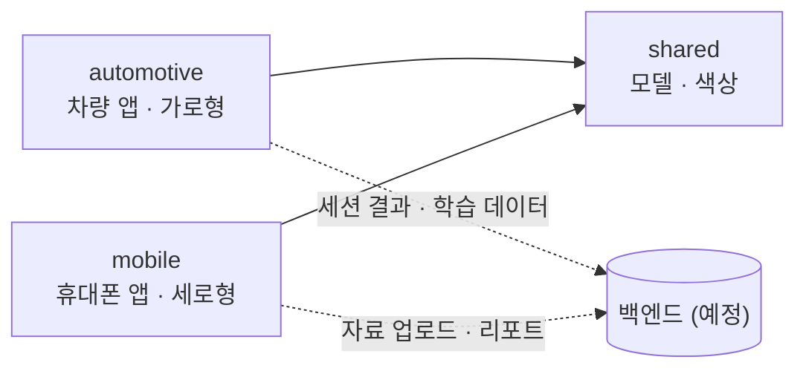

# RoadStudy Frontend
자차 출퇴근 직장인이 올린 공부 자료를 출퇴근길 오디오 학습으로 바꿔주고, 운전이 쉬운 순간에만 말을 거는 자기계발 학습 코치 앱 **로드스터디(RoadStudy)** 입니다.

## 🚀 Tech Stack

### Framework & Library


## 💻 Code Convention

### 네이밍 룰(Naming Rules)

1. **패키지 네이밍** - 항상 소문자로 작성하고 언더스코어( _ )를 사용하지 않으며, 여러 단어를 연결하는 경우 카멜 케이스를 사용합니다.
2. 클래스 네이밍 - 대문자로 시작하는 파스칼 케이스를 사용합니다.

```kotlin
class MyClass : MyInterface {
    ...
}
```

3. 메소드, 변수 네이밍 - 소문자로 시작하는 카멜 케이스를 사용합니다.

```kotlin
//변수 예시
private var myProperty: Int

//메소드 예시
fun myMethod() {
    ...
}
```

4. 상수 네이밍 - 대문자와 언더스코어로 구분된 어퍼 케이스를 사용합니다.

```kotlin
const val MAX_COUNT = 8
val USER_NAME_FIELD = "UserName"
```

### 소스코드 구성(Source code organization)

클래스의 내용은 다음 순서로 작성합니다.

1. 속성 선언과 초기화 블록
2. 보조 생성자
3. 메소드 선언

```kotlin
//클래스 예시
class MyClass {

    // 속성 선언
    private val property1: String
    private val property2: Int

    // 초기화 블록
    init {
        property1 = "Hello"
        property2 = 42
    }

    // 보조 생성자
    constructor(param1: String) { ... }

    // 보조 생성자
    constructor(param1: String, param2: Int) { ... }

    // 메소드 선언
    fun method1() { ... }

    // 메소드 선언
    fun method2() {
    	InternalNestedClass()
    	... 
    }

    // 내부에서 사용된 Nested classes
    private class InternalNestedClass { ... }

    // Companion object
    companion object { ... }

    // Nested classes
    class NestedClass { ... }

    // 외부에서 사용된 Nested classes 
    class ExternalNestedClass { ... }
}
```

### 형식 (Formatting)

1. 들여쓰기 - 들여쓰기에는 네 개의 공백을 사용합니다.
2. 콜론( : ) - 다음 경우에는 콜론 앞에 공백을 넣습니다.
    - 타입과 상위 타입을 구분하는 데 사용될 때
    - 슈퍼클래스 생성자로 위임하거나 동일한 클래스의 다른 생성자로 위임할 때
    - "object" 키워드 뒤에 사용될 때
    - 선언과 해당하는 타입을 구분하는 콜론 앞에는 공백을 넣지 마세요.
    - 콜론 뒤에는 항상 공백을 넣으세요.

참고 자료: https://kotlinlang.org/docs/coding-conventions.html#verify-that-your-code-follows-the-style-guide,  https://effortguy.tistory.com/257

## 🛠️ Branch Strategy

### 브랜치 유형

| 브랜치 유형 | 내용 |
| --- | --- |
| `main` | 완성된 버전의 코드를 저장하는 브랜치 |
| `dev` | 개발이 진행되는 동안 완성된 코드를 저장하는 브랜치 |
| `feat` | 작은 단위의 작업이 진행되는 브랜치 |
| `hotfix` | 긴급한 오류를 해결하는 브랜치 |

### 브랜치 명

- 유형/#이슈번호-what
    
    ex) feat/#30-home-ui,  init/#1-add-font
    

| 카테고리 | 내용 |
| --- | --- |
| `feat` | 구현 |
| `mod` | 수정 |
| `add` | 추가 |
| `del` | 삭제 |
| `fix` | 버그 수정 |
| `refactor` | 리팩토링 |

## 📔 Git Convention

### Git Flow

1. Issue 생성
2. Branch 생성
3. Add - Commit - Push - Pull Request(PR)
    1. Commit은 최대한 자주, 적은 양
    2. Commit시에 Issue를 연결
4. PR이 작성되면 작성자 이외의 다른 팀원이 Code Review를 진행합니다.
5. Code Review가 완료되면 PR 작성자가 dev Branch로 Merge 합니다.
    1. Merge 후 카톡방에 무조건 공유합니다.
6. Merge 된 작업이 있으면 다른 브랜치에서 작업을 진행 중이던 개발자는 본인의 브랜치로 Merge된 작업을 Pull 받아옵니다. (최신화 습관 들이기!)

### 협업 규칙

- dev 브랜치에서의 작업은 금지합니다. 단, 초기 세팅 및 README 작성은 dev 브랜치에서 수행 가능합니다.
- 본인의 PR은 본인이 Merge합니다.
- Commit, Push, Merge, PR 등 모든 작업은 앱이 정상적으로 실행되는지 확인 후 수행합니다.

### Issue Convention

[카테고리] 제목 

ex) [INIT] 프로젝트 초기 세팅 

### Commit Convention

[커밋 카테고리/#이슈번호] 커밋 내용 (대문자)

ex) [FEAT/#30] 홈 뷰 구현, [ADD/#1] 폰트 파일 추가

| 커밋 카테고리 | 내용 |
| --- | --- |
| `feat` | 기능 (feature) |
| `fix` | 버그 수정 |
| `docs` | 문서 작업 (documentation) |
| `style` | 포맷팅, 세미콜론 누락 등, 코드 자체의 변경이 없는 경우 |
| `refactor` | 리팩토링 : 결과의 변경 없이 코드의 구조를 재조정 |
| `test` | 테스트 |
| `chore` | 변수명, 함수명 등 사소한 수정 *ex) .gitignore* |

### PR Convention

[카테고리/#이슈번호] 제목

ex) [FEAT/#6] 로그인 뷰 구현


## 📦 모듈 구조

| 모듈 | 내용 |
| --- | --- |
| `automotive` | 차량 앱 (가로형). Pleos Connect에서 실행하며, Pleos SDK는 이 모듈에서만 사용 |
| `mobile` | 휴대폰 앱 (세로형). 홈, 내 자료, 성장 리포트, 설정 |
| `shared` | 두 앱이 함께 쓰는 데이터 모델과 색상 값 (앱이 아닌 라이브러리) |

- 앱은 `automotive`, `mobile` 두 개가 나오고, `shared`는 두 앱이 가져다 씁니다.
- 패키지: `com.roadstudy.automotive`, `com.roadstudy.mobile`, `com.roadstudy.shared`

### 의존 관계



- 실선은 코드 의존입니다. `automotive`와 `mobile`은 서로를 참조하지 않고, 둘 다 `shared`만 참조합니다.
- 점선은 통신입니다. 두 앱은 직접 통신하지 않고 백엔드하고만 통신합니다. 백엔드 연결은 아직 구현 전입니다.

### 폴더 구조

```
roadstudy-frontend
├── automotive                          차량 앱
│   └── src/main/java/com/roadstudy/automotive
│       └── session                     학습 모드 판단, 세션 진행 로직 (단위 테스트 포함)
├── mobile                              휴대폰 앱
│   └── src/main/java/com/roadstudy/mobile
│       ├── main                        MainActivity, 하단 탭
│       └── today · mydata · growth · setting    탭별 화면(Fragment)
└── shared                              공용 라이브러리
    └── src/main
        ├── java/com/roadstudy/shared/model      StudySection, Concept 등 데이터 모델
        └── res/values/colors.xml                색상 값
```

## ⚙️Android Studio 환경 설정
버전 : Rabbit 2

AGP : 9.5.1

compileSDK / targetSDK : 37

minSDK : 28 (전 모듈 공통, Pleos Connect 차량 보안 요건)

### 테스트 환경

| 모듈 | 실행 환경 |
| --- | --- |
| `mobile` | 일반 휴대폰 에뮬레이터 (Phone, API 28 이상) |
| `automotive` | Pleos Connect Emulator v2.1.0 (API 34) + Virtual Console. **휴대폰 에뮬레이터 사용 금지** |

Pleos Connect Emulator 설치: https://document.pleos.ai/docs/connect/guide/getting-started/application-development/setup-connect-sdk-emulator
